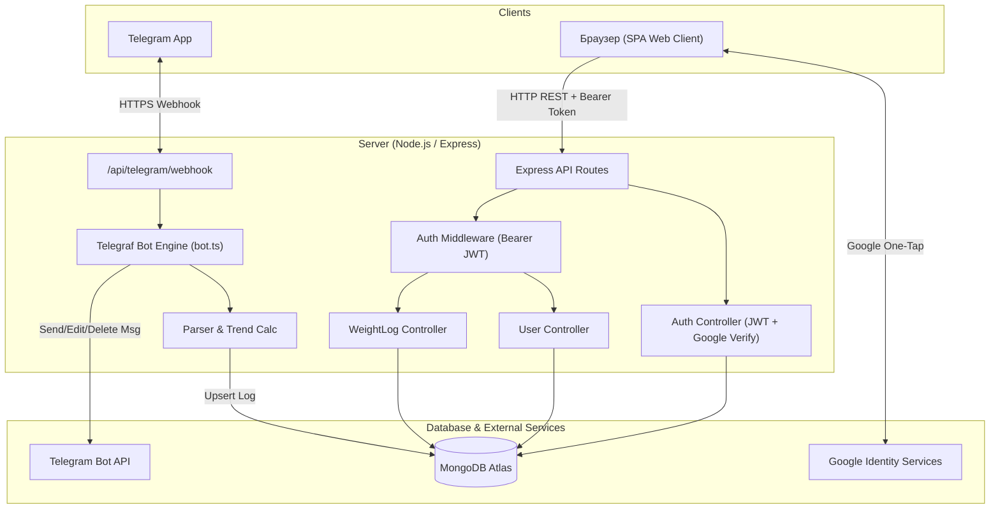
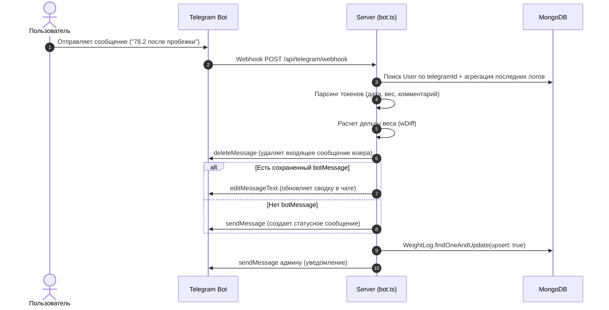
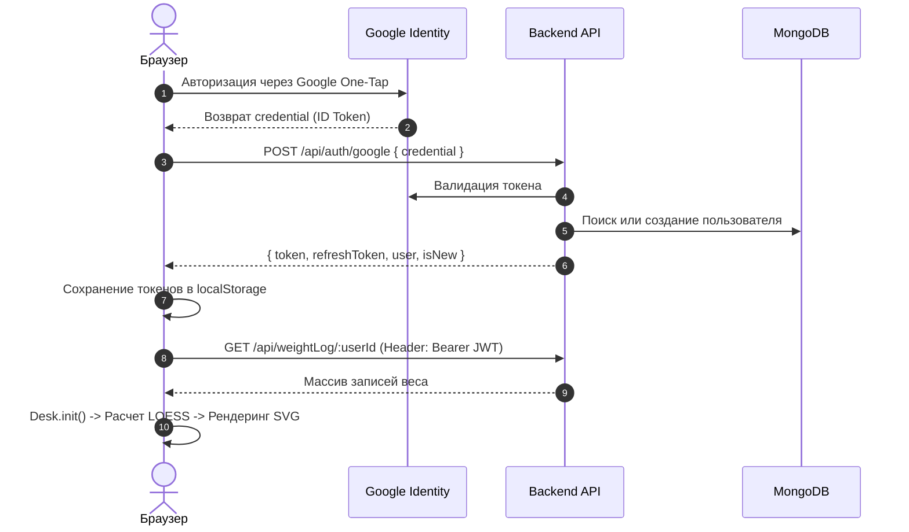

# Архитектура проекта Liner

## 1. Обзор системы

**Liner** — сервис для трекинга динамики веса, визуализации трендов и прогнозирования достижения целей с помощью Telegram-бота и интерактивного веб-клиента.

### Ключевые возможности:
- **Telegram Bot:** Ежедневный ввод веса с поддержкой синтаксиса ретроспективных дат, комментариев, автоматического удаления служебных сообщений и рассылки напоминаний.
- **Интерактивный график (Desk):** Координатный холст на SVG/CSS с поддержкой drag & zoom, отображением исходных точек, пропусков, двух уровней сглаживания LOESS (15 и 45 дней), расчетных касательных тренда (скорость сброса/набора веса в день/неделю/месяц) и прогноза даты достижения цели.
- **Личный кабинет & Сообщество:** Авторизация через Google One-Tap, публичные и приватные профили участников, цели по весу.

---

## 2. Структура монорепозитория

Проект организован как npm workspaces:

```
liner/
├── client/              # Фронтенд: SPA на Vite + TypeScript + SCSS + Web Components
│   ├── src/
│   │   ├── components/  # Пользовательские веб-компоненты (<c-desk>, <c-users-list>, ...)
│   │   ├── pages/       # Модули страниц (home, user, settings, welcome, register)
│   │   ├── services/    # API клиент, аутентификация, кэш, auth guard
│   │   ├── styles/      # Глобальные SCSS стили
│   │   ├── router.ts    # Легковесный клиентский роутер (RegExp + History API)
│   │   └── main.ts      # Точка входа приложения
├── server/              # Бэкенд: Node.js (ESM) + Express + Telegraf + Mongoose
│   ├── src/
│   │   ├── controllers/ # Обработчики маршрутов (auth, user, weightLog, telegram)
│   │   ├── models/      # Mongoose-модели (User, WeightLog)
│   │   ├── routes/      # Определение Express-роутов
│   │   ├── schemas/     # Валидация входных данных (Zod)
│   │   ├── utils/       # Генерация и верификация JWT
│   │   ├── bot.ts       # Telegram-бот, парсер ввода, рассылка, cron-напоминания
│   │   └── index.ts     # Точка входа сервера и вебхук Telegram
├── shared/              # Общие типы для клиента и сервера
│   └── types/           # IUser, IGoal, IWeightLog
├── _base/               # Git-субмодуль с переиспользуемыми модулями
│   ├── server/          # db.ts (подключение к Mongo), config.ts (загрузка .env)
│   └── client/          # EventEmitter, базовые SCSS
├── _tools/              # Утилиты миграции и сопровождения
│   ├── Importweightfromsheets.ts # Импорт из Google Sheets API
│   ├── setWebhook.ts    # Настройка Webhook для ngrok/production
│   └── snap.ts          # Сборка слепка проекта для LLM
├── GLOSSARY.md          # Глоссарий предметной области
└── ARCHITECTURE.md      # Архитектурное описание проекта
```

---

## 3. Архитектурная диаграмма



---

## 4. Клиентская архитектура (Frontend)

Фронтенд построен **без тяжелых фреймворков** (React/Vue/Angular), опираясь на нативные стандарты браузера:
- **Custom Elements (Web Components):** `<c-desk>`, `<c-users-list>`, `<c-user-menu>`, `<c-telegram-banner>`. Инкапсулируют поведение через жизненный цикл `connectedCallback`.
- **SPA Router ([router.ts](file:///d:/_sites/liner/client/src/router.ts)):**
  - Перехват кликов по ссылкам `<a>` и модификация истории через `history.pushState`.
  - Маршрутизация по регулярным выражениям (включая параметризованные URL вида `/user/:id`).
  - Рендеринг HTML-шаблона в `<main>` и вызов метода `init()` для связывания слушателей событий.
- **Ядро визуализации ([Desk.ts](file:///d:/_sites/liner/client/src/components/c-desk/Desk.ts)):**
  - **Координатная сетка:** Вычисляется динамически на базе дат и экстремумов веса.
  - **Фоновые SVG-подложки:** Формируются в виде Data-URL в свойстве `background-image` (вертикальные полосы дней недели, горизонтальные линии целых значений веса, шкалы дат).
  - **Кривые веса:** Слой `<svg>` с полилиниями сырых данных (пунктир для пропущенных дней).
  - **LOESS-сглаживание:** Реализация алгоритма локальной взвешенной линейной регрессии с трикубической весовой функцией для окон в 15 и 45 дней.
  - **Касательная тренда:** Определение первой производной в текущей точке и графическое построение линии вектора скорости изменения массы.

---

## 5. Серверная архитектура (Backend)

Серверная часть спроектирована по модульному принципу Express 5.x:
- **Обработка вебхука Telegram:** Эндпоинт `POST /api/telegram/webhook` делегирует входящие обновления инстансу `bot.handleUpdate(req.body, res)`.
- **Интеллектуальный ввод данных:**
  - Поддержка форматов: `72.4`, `15 72.4`, `15.04 72.4`, `15.04.26 72.4`, а также комментариев: `72.4 после тренировки`.
  - Автоматический расчет суточной дельты относительно предыдущей записи.
  - Очистка чата: удаление входящего сообщения пользователя для поддержания аккуратного дашборда внутри Telegram.
- **Безопасность и сессии:**
  - Проверка ID-токена Google через официальную библиотеку `google-auth-library`.
  - Выпуск собственного JWT: короткоживущий Access Token (15 мин) и долгоживущий Refresh Token (30 дней).
- **Фоновые напоминания (`doReminder`):**
  - Вызывается внешним планировщиком `GET /api/telegram/remind?password=...` (также `/reminder`).
  - Находит активных пользователей без сегодняшней записи и обновляет сервисное сообщение с указанием дней пропуска.

---

## 6. Модели данных (MongoDB / Mongoose)

### 6.1. Коллекция `users`
Хранит профили пользователей, связку с Telegram и цели:
```typescript
{
  googleId: string;       // Уникальный идентификатор Google
  name: string;           // Отображаемое имя
  isRegistered: boolean;  // Завершен ли первичный онбординг
  telegramId?: number;    // ID в Telegram (для привязки бота)
  token?: string;         // Токен последней активной сессии
  createdAt: Date;
  settings: {
    account: { weightStart?: number };
    privacy: { showMyPage: boolean }; // Публичность страницы
    goals: [{
      title: string;
      startWeight?: number;
      targetWeight?: number;
      startDate?: Date;
      endDate?: Date;
    }];
  };
  botMessage?: {          // Последнее служебное сообщение в боте
    chatId: number;
    messageId: number;
    date: Date;
  };
}
```

### 6.2. Коллекция `weightlogs`
Хранит историю ежедневных взвешиваний:
```typescript
{
  userId: ObjectId;       // Ссылка на коллекцию users (ref: "User")
  date: Date;             // Дата замера (нормализована на 12:00 UTC)
  weight: number;         // Вес в кг
  comment?: string;       // Текстовый комментарий (удаляется, если пустой)
}
// Составной уникальный индекс: { userId: 1, date: 1 }
```

---

## 7. Потоки данных (Data Flow)

### 7.1. Ввод веса через Telegram:


### 7.2. Аутентификация и инициализация Web SPA:

